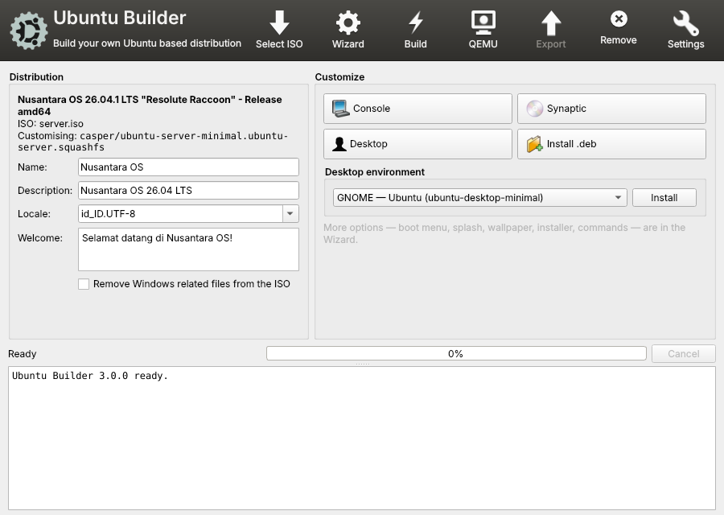

# Ubuntu Builder

Build your own Ubuntu based distribution.

Versi 3 dari [Ubuntu Builder](https://launchpad.net/ubuntu-builder) (2.5.2, 2014, karya Francesco
Muriana), ditulis ulang dengan Python 3.12+ dan Qt 6 untuk Ubuntu 20.04 hingga 26.10. Alur kerja
dan jendelanya sama dengan versi 2.x — **Select ISO → Console / Synaptic / Desktop / Wizard →
Build → QEMU** — dengan mesin di baliknya yang diperbarui untuk 2026.



## Fungsi tiap tombol

| Tombol | Versi 2.x | Versi 3 |
|---|---|---|
| **Select ISO** | Memilih file `.iso` | File lokal, atau unduh rilis resmi (daftar rilis, status EOL, flavor, dan ISO diambil langsung dari ubuntu.com; unduhan resumable + verifikasi SHA-256) |
| **Wizard** | Paket, `.deb`, perintah otomatis, lalu build | Paket, desktop environment, menu boot GRUB, Plymouth, wallpaper & tema, autoinstall Subiquity, Calamares, perintah; opsional langsung build |
| **Build** | `genisoimage`, hanya BIOS | Menerapkan panel Distribution, repack squashfs (xz/zstd/…), `md5sum.txt`, ISO hybrid `xorriso` untuk BIOS + UEFI + Secure Boot |
| **QEMU** | Uji ISO | Uji ISO dalam mode BIOS atau UEFI (OVMF) |
| **Export** | Burn / USB live | Buka folder, tulis ke USB (GNOME Disks, usb-creator, mintstick…), burn (Brasero, K3b, Xfburn) |
| **Remove** | Hapus `/home/ubuntu-builder` | Hapus image hasil ekstrak (ISO unduhan tetap disimpan) |
| **Settings** | — | Folder workspace, gaya toolbar gelap/terang (set ikon `Light`/`Dark` asli), ukuran jendela Desktop, pemeriksaan paket host |
| **Console** | Terminal chroot eksternal | Terminal chroot tertanam (atau terminal sistem) |
| **Synaptic** | Synaptic dari dalam image | Sama — dipasang otomatis bila belum ada, tampil di display host (X11 atau XWayland) |
| **Desktop** | Sesi desktop image di Xephyr | Sama — GNOME, Plasma, Xfce, LXQt, MATE, Budgie, Cinnamon, Openbox |
| **Install .deb** | Pasang `.deb` lokal | Sama, dependensi diselesaikan oleh apt |
| **Desktop environment** | Preset paket | `ubuntu-desktop-minimal`, `kubuntu-desktop`, `xubuntu-desktop`, `lubuntu-desktop`, `ubuntu-mate-desktop`, `ubuntu-budgie-desktop`, `ubuntucinnamon-desktop` |

Panel **Distribution** menggantikan berkas `configs/` lama: nama distro (`DIST`), deskripsi
(`DESCRIPTION`), locale (`LOCALE`), pesan sambutan (motd), dan hapus file Windows (`WIN`).

## Instalasi

### Paket Debian

```bash
dpkg-buildpackage -us -uc -b
```

```bash
sudo apt install ../ubuntu-builder_3.0.0_all.deb
```

Menu aplikasi: *Ubuntu Builder*, atau perintah `ubuntu-builder`. Aplikasi berjalan sebagai pengguna
biasa; untuk ekstrak, chroot, dan build, polkit meminta sandi administrator (sekali per beberapa
menit, lewat `/usr/libexec/ubuntu-builder/ubuntu-builder-helper`).

### Dari source

```bash
./install_host_deps.sh --with-qemu
```

```bash
python3 -m venv .venv && .venv/bin/pip install -r requirements.txt
```

```bash
PATH="$PWD/.venv/bin:$PATH" src/ubuntu-builder/ubuntu-builder
```

### Baris perintah

```bash
sudo src/ubuntu-builder/ubuntu-builder-cli -w ~/remaster extract ubuntu-26.04.1-desktop-amd64.iso
```

```bash
sudo src/ubuntu-builder/ubuntu-builder-cli -w ~/remaster shell
```

```bash
sudo src/ubuntu-builder/ubuntu-builder-cli -w ~/remaster build ~/MyDistro-26.04.iso --volume-id "MyDistro 26.04"
```

Perintah lain: `preflight`, `inspect`, `customize`, `synaptic`, `desktop`, `cleanup`, `delete`
(lihat `ubuntu-builder-cli --help`).

## Struktur source

Mengikuti tata letak tarball asli (`src/ubuntu-builder/` + `debian/`):

```
.
├── debian/                          # paket .deb (debhelper 13, native 3.0.0)
│   ├── changelog                    #   riwayat lengkap sejak 2010
│   ├── control, rules, install, copyright, manpages, man/
│   └── ubuntu-builder.desktop
├── src/ubuntu-builder/
│   ├── ubuntu-builder               # launcher GUI   → /usr/bin
│   ├── ubuntu-builder-cli           # launcher CLI   → /usr/bin
│   ├── ubuntu-builder-helper        # helper root    → /usr/libexec/ubuntu-builder
│   ├── org.ubuntu-builder.policy    # aksi polkit
│   ├── ubuntu-builder.png           # logo asli
│   ├── icons/{Dark,Light}/          # ikon toolbar asli 2.x
│   └── ubuntu_builder/              # → /usr/share/ubuntu-builder
│       ├── app.py, cli.py
│       ├── models/                  #   MODEL: release, workspace, customization
│       ├── core/                    #   backend tanpa Qt: scraper, downloader, preflight,
│       │                            #   runner, iso, layers, chroot, customizer, graphical, backend
│       ├── controllers/             #   CONTROLLER: main_controller, workers (QThread)
│       └── views/                   #   VIEW: main_window, dialogs, get_iso_dialog,
│                                    #   customize_page, terminal, resources
├── legacy/2.5.2/                    # skrip Bash asli (Extract, Build, Wizard, …) sebagai referensi
├── tests/                           # pytest — tanpa root, tanpa jaringan
├── install_host_deps.sh, requirements.txt, pyproject.toml
```

## Catatan & batasan

- **Image berlapis (23.04+):** perubahan disimpan di satu lapisan yang dipilih saat ekstrak (bawaan:
  sumber instalasi default). Lapisan di atasnya (mis. sesi live) tetap seperti aslinya.
- **Secure Boot** memakai ulang boot loader bertanda tangan dari ISO sumber. Hanya bila ISO sumber
  tidak punya boot record, boot image dibuat dengan `grub-mkimage`/`mtools` (tidak bertanda tangan).
- **Wallpaper/tema** diterapkan lewat GSettings (desktop berbasis GNOME); Plasma dan Xfce belum.
- **Console tertanam** berorientasi baris; untuk `nano`/dialog debconf pakai *Open in system terminal…*.
- **Desktop/Synaptic** memerlukan display X (X11 atau XWayland); Desktop memerlukan `xserver-xephyr`.
- Hanya amd64 yang diuji. Field `Maintainer` di `debian/control` masih placeholder.

## Pengembangan

```bash
.venv/bin/pip install -r requirements-dev.txt
```

```bash
.venv/bin/pytest && .venv/bin/ruff check src tests
```

## Lisensi

GPL-3.0-or-later. Ubuntu Builder 2.x dan ikonnya © 2010–2014 Francesco Muriana (GPL-2+).
